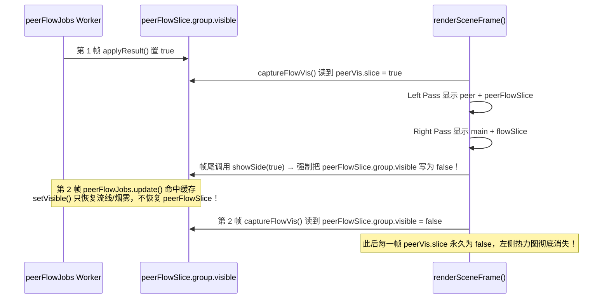

# 卷帘对比模式（Curtain Mode）全参数与 PIV 截面热力图 100% 同步修复说明

> **文档用途**：本说明面向接手执行的开发 Agent，聚焦解决**卷帘分屏对比模式下左/右双车状态不同步（核心表现为左侧副车缺失 PIV 激光截面热力图）**的单一专项问题，使左侧对比车在几何姿态、运动机构、流场可视化、PIV 切片、探针采样与 2K 导出等全部维度上 100% 复刻右侧主车参数。
>
> **目标代码基线**：`/Users/louis/Suep/Project/AERO` 当前本地工作区（Wave 1 状态，未改动线上 `46e5ce8`）。

---

## 1. 红线与范围边界（接手 Agent 必读）

1. **严守改动范围（单一专项修复）**：
   - **仅修改**本文档第 4 节列出的 6 个文件，只解决卷帘模式双车全参数与可视化同步问题。
   - **严禁**附带做任何无关改动：不要做静态网格合批、不要改流线默认色标、不要改移动端顶栏布局、不要改默认车型/默认风速/热点或模型来源文案。
2. **遵守项目铁律（见仓库根目录 `AGENTS.md`）**：
   - 保持 4 控件纯风洞物理模型（风洞风速/车速、偏航角、前轮转向、DRS 尾翼）。
   - 保持全参数连续流线显示与三层状态区分、拖滑块实时更新。
   - 严禁为“阴影同步”而把 `renderer.shadowMap.autoUpdate` 改为 `true`（双 Pass 下会使 GPU 阴影渲染翻倍）。
3. **交付门禁**：
   - 修改完成后仅在本地执行校验、构建并在本地预览（`http://127.0.0.1:4173/`）实测验收；**未经 Sir 明确批准，严禁 `git push` 或部署线上服务器**。

---

## 2. 核心根因分析：为什么左侧车没有 PIV 截面热力图？

在当前 [web/src/main.js](file:///Users/louis/Suep/Project/AERO/web/src/main.js)（L2206–2260）中，卷帘双车渲染使用单 WebGLRenderer 的双 Scissor Pass，但**复用 `group.visible` 同时表达“数据是否就绪”和“当前 Pass 是否显示”**，产生了致命状态破坏：



### 同根源引发的第二个隐藏 Bug（2K 卷帘截图左半屏失流）
同样由于 `renderSceneFrame` 帧尾的 `showSide(true)` 把 `peerFlowLayers`、`peerFlowPreview`、`peerFlowSmoke`、`peerFlowSlice` 的 `.visible` 全部置为 `false`：
- 当用户点击 **「导出 2K 高清 PNG」** 时，[photo-capture.js](file:///Users/louis/Suep/Project/AERO/web/src/photo-capture.js) 直接在点击回调中调用 `renderSceneFrame(targetW, targetH, underCar)`，此时下一帧的 `peerFlowJobs.update()` 尚未运行；
- `captureFlowVis` 读到 `peer` 的流线、烟雾、PIV 切片全部为 `false`，导致导出的 2K 卷帘截图左半屏缺失流线、烟雾与切片！

---

## 3. 全维度同步体检矩阵（12 项参数与图层）

以下列出卷帘模式下需要左侧对比车 100% 复刻右侧主车的全部 12 项维度、当前代码实况及修复要求：

| # | 同步维度 | 当前状态 | 缺陷/风险说明 | 目标修复动作 |
|---|---|---|---|---|
| 1 | **PIV 激光切面热力图**（开关/轴向 `X/Z/Y`/位置/物理量速度与涡量） | ❌ **失效** | 帧尾 `showSide(true)` 把 `peerFlowSlice.group.visible` 置 `false`，第 2 帧起永久消失；`onReset` 未清空数据标记 | `FlowSlice` 增加 `hasData` + `clear()`；`captureFlowVis` 按 `sliceWant && slice.hasData` 计算；帧尾恢复双侧逻辑显隐 |
| 2 | **2K 卷帘分屏截图** | ❌ **缺陷** | 点击导出时 `peer` 流线/烟雾/切片均处于上一帧 `showSide(true)` 留下的 `false` 状态，左半屏缺失流体图层 | `renderSceneFrame` 帧尾对 `main` 与 `peer` 均按 `mainVis`/`peerVis` 恢复逻辑显隐（仅保持 `peerModel.visible = false`） |
| 3 | **流线样式（CFD 细线 ↔ 风洞烟雾流）与烟耙横向位置** | ⚠️ **部分缺失** | `setFlowStyle()`（L1668）只调用了 `flowJobs.setVisible(...)`，未同步调用 `peerFlowJobs?.setVisible(...)` | 补齐 `peerFlowJobs?.setVisible(state.flow && state.flowDensity > 0)` |
| 4 | **卷帘内「流场/切片」工具面板入口** | ❌ **缺失** | 进入卷帘时 `#app.is-curtain-mode .rail` 被强制隐藏，用户无法在卷帘中调节切片/烟雾/探针 | 卷帘顶栏新增「流场/切片」按钮（`#compare-curtain-tools`），按需展开/收起左侧栏，不退出卷帘 |
| 5 | **空间虚拟皮托管探针** | ❌ **仅测主车** | `peerFlowJobs.extras.needsField` 缺 `flowProbe.enabled`，无 `onProbeResult`；指针划过左半屏仍采样主车 `rig`/`flowSlice`/`flowJobs` | 按分界线 `ratio` + `curtainSwapped` 动态路由左右侧 `rig`/`slice`/`jobs`，钉住状态跟随归属车，浮窗显示 `[RB16B]`/`[RB19]` 角标 |
| 6 | **轮速纯滚动（`groundSpeed` → `state.spin`）** | ⚠️ **1 处遗漏** | 动画主循环已按线性路程 `spin` 同步双车（`rig.js:116` 按各自真实胎径 `0.332m`/`0.369m` 换算角速度，零打滑）；但 `window.aeroStudio.setPose()`（L2436）漏调 `applyRig(peerRig, ...)` | 在 `setPose()` 补齐 `peerRig` 同步调用，确保编程/脚本设姿也 100% 同步 |
| 7 | **前轮转向角（`steer` ±18°、阿克曼拉杆、RB19 碳纤整流罩）** | ✅ 已同步（需复验） | 动画主循环 L2301–2303 与加载完成 L1955 均同步 `applyRig(peerRig, ...)` | 联同 `setPose()` 一并同步并纳入验收断言 |
| 8 | **DRS 尾翼实际姿态（`drsCurrent` 0→1 平滑过渡）** | ✅ 已同步（需复验） | 同上，同步实际阻尼姿态 `state.drsCurrent`，避免穿模 | 纳入验收断言（验证开启/关闭过渡中双车开度同步） |
| 9 | **风洞风速 / 偏航角 / 转台旋转（`groundSpeed`/`windAngle`）** | ✅ 已同步（需复验） | `currentModel`、`peerModel` 及双侧全部流场/烟雾/切片均挂载在同一个 `carTurntable` 下；`peerFlowJobs.update({ ...state, model: peerCarId }, peerRig, now)` 透传完整 `state` | 纳入验收断言（含 `0 km/h` 静止归零再拉起、`±45°` 偏航旋转） |
| 10 | **流线密度 / 流线总开关 / 失败重试按钮** | ⚠️ **1 处遗漏** | 密度与开关已每帧透传；但 `#flow-retry`（L2163）仅重置主车，未重置 `peerFlowCatalog` / `peerFlowJobs` | 在 `#flow-retry` 补齐 `if (curtainCompare.active) { peerFlowCatalog?.retry(); peerFlowJobs?.reset(); }` |
| 11 | **`⇄ 互换` 后「（主车）」标签与双击车身聚焦** | ⚠️ **小缺陷** | `CurtainCompare.setCars()`（`aero-compare.js:298`）写死右侧标 `（主车）`，互换后标签不跟随；`dblclick`（L922）只射线检测 `currentModel` | `setCars(leftCar, rightCar, mainCar)` 让 `（主车）` 跟随实际主车；`dblclick` 在卷帘下按点击左右侧命中对应车型 |
| 12 | **PIV 热力图色标归一化一致性** | ✅ 已对齐（确认即可） | `flow-worker.js:55-120` 中 `computeSlice` 对双车均使用同一 `refSpeedMps = Math.max(1, state.speed / 3.6)` 与同一速度/涡量色阶，跨越分界线可直接等标尺对比 | 无需改动，保留即可 |

---

## 4. 逐文件精确修改方案

### 4.1 [web/src/flow-slice.js](file:///Users/louis/Suep/Project/AERO/web/src/flow-slice.js)

**目的**：新增 `hasData` 逻辑数据标志与 `clear()` 方法，使“切片是否有有效热力图数据”与“Three.js 渲染显隐 `group.visible`”彻底解耦。

1. 构造函数末尾（L68 `this.lastBounds = null;` 之后）新增：
   ```js
   this.hasData = false;
   ```
2. 新增 `clear()` 并更新 `setVisible()`（原 L71–73）：
   ```js
   clear() {
     this.hasData = false;
     this.lastBounds = null;
     this.group.visible = false;
   }

   setVisible(visible) {
     this.group.visible = Boolean(visible && this.hasData && this.lastBounds);
   }
   ```
3. `applyResult(result)` 中（原 L75–95）：
   - 当 `!result?.rgba || !result.width || !result.height` 时，额外设置 `this.hasData = false;`。
   - 在 `this.lastBounds = bounds;` 之后设置 `this.hasData = true;`。

---

### 4.2 [web/src/flow-probe.js](file:///Users/louis/Suep/Project/AERO/web/src/flow-probe.js)

**目的**：支持卷帘模式下显示当前探针采样的是哪辆车的流场（`[RB16B]` / `[RB19]`），非卷帘模式传入 `null` 保持原样式不变。

1. `applyResult`（原 L153–161）：
   ```js
   applyResult(result, refSpeedMps, carLabel = null) {
     if (!this.enabled) return;
     if (!result?.valid) {
       if (!this.pinned) {
         this.clearResult();
       }
       return;
     }
     this.lastResult = { ...result, refSpeedMps, carLabel };
   ```
2. `updateOverlay`（原 L211–219）：
   ```js
   const contentKey = `${r.carLabel || ''}|${Math.round(r.speedKmh)}|${r.speedMps.toFixed(1)}|${ratioText}|${r.yawDeg.toFixed(1)}|${x.toFixed(2)}|${y.toFixed(2)}|${z.toFixed(2)}|${this.pinned ? 1 : 0}`;
   if (this._lastHtmlKey !== contentKey) {
     this._lastHtmlKey = contentKey;
     const carBadge = r.carLabel ? `<em class="probe-car">${r.carLabel}</em>` : '';
     this.overlay.innerHTML =
       `<div class="probe-head">${carBadge}<strong>${Math.round(r.speedKmh)} km/h</strong><span>${r.speedMps.toFixed(1)} m/s</span>`
       + (this.pinned ? '<em class="probe-pin">已钉住</em>' : '')
       + `</div><div class="probe-sub">${ratioText} · 偏转 ${r.yawDeg >= 0 ? '+' : ''}${r.yawDeg.toFixed(1)}°</div>`
       + `<div class="probe-coords">X ${x.toFixed(2)} · Y ${y.toFixed(2)} · Z ${z.toFixed(2)} m</div>`;
   }
   ```

---

### 4.3 [web/src/aero-compare.js](file:///Users/louis/Suep/Project/AERO/web/src/aero-compare.js)

**目的**：点击 `⇄ 互换` 后，`（主车）` 标签跟随实际主车，而不是写死在右侧。

- 修改 `CurtainCompare.setCars` 与 `activate`（原 L268–296）：
  ```js
  setCars(leftCar, rightCar, mainCar = rightCar) {
    this.leftCar = leftCar;
    this.rightCar = rightCar;
    const fmt = id => (id === 'rb19' ? 'RB19 · 2023' : 'RB16B · 2021');
    if (this.leftLabel) {
      this.leftLabel.textContent = `左 · ${fmt(leftCar)}${leftCar === mainCar ? '（主车）' : ''}`;
      this.leftLabel.dataset.car = leftCar;
    }
    if (this.rightLabel) {
      this.rightLabel.textContent = `右 · ${fmt(rightCar)}${rightCar === mainCar ? '（主车）' : ''}`;
      this.rightLabel.dataset.car = rightCar;
    }
  }
  ```
  `activate({ leftCar, rightCar })` 仍调用 `this.setCars(leftCar, rightCar, rightCar)`。

---

### 4.4 [web/index.html](file:///Users/louis/Suep/Project/AERO/web/index.html)

**目的**：在卷帘顶部工具栏增加「流场/切片」显隐开关按钮，方便在卷帘中不退出的情况下直接开关/滑动 PIV 切片、烟雾流与探针。

- 在 `.curtain-bar-actions`（原 L27–32）最前面增加 1 个按钮：
  ```html
  <div class="curtain-bar-actions">
    <button id="compare-curtain-tools" type="button" class="chip" aria-pressed="false" title="在卷帘模式下展开/收起流场与 PIV 切片调节">流场/切片</button>
    <button id="compare-curtain-swap" type="button" class="chip" title="互换左右半屏车型">⇄ 互换</button>
    <button id="compare-curtain-center" type="button" class="chip" title="分界线回到正中（或双击分界线）">50%</button>
    <button id="compare-curtain-exit" type="button" class="chip curtain-exit">退出卷帘</button>
  </div>
  ```

---

### 4.5 [web/src/style.css](file:///Users/louis/Suep/Project/AERO/web/src/style.css)

**目的**：支持卷帘内按需展开左侧工具栏，并为探针车型角标增加样式。

1. 在 `#app.is-curtain-mode .rail`（原 L278–281）之后追加：
   ```css
   #app.is-curtain-mode.curtain-tools-open .rail {
     opacity: 1;
     pointer-events: auto;
   }
   ```
2. 在 `.probe-head span`（原 L2041）之后追加：
   ```css
   .probe-car {
     font-style: normal;
     font-size: 9.5px;
     font-weight: 700;
     padding: 1px 5px;
     border-radius: 4px;
     background: rgba(255, 255, 255, 0.14);
     color: #edf1f6;
     letter-spacing: 0.03em;
   }
   ```

---

### 4.6 [web/src/main.js](file:///Users/louis/Suep/Project/AERO/web/src/main.js)

所有修改集中于以下 9 个精确位置：

#### (1) 主车 `flowJobs.setExtras`（L254–288）
- `onProbeResult` 传入卷帘车型角标：
  ```js
  onProbeResult: res => {
    const label = curtainCompare?.active ? state.model.toUpperCase() : null;
    flowProbe.applyResult(res, Math.max(1, (state.speed || 0) / 3.6), label);
  },
  ```
- `onReset` 改为调用 `flowSlice.clear()`（替代 `flowSlice.setVisible(false)`）。
- `onFieldUpdated` 改为基于 `hasData` 且区分探针钉住归属：
  ```js
  onFieldUpdated: () => {
    if (flowProbe.enabled && flowProbe.pinned && flowProbe.pinnedRequest && !probePinnedIsPeer) {
      flowJobs.requestProbe(flowProbe.pinnedRequest);
    }
    if (studioExt.sliceEnabled && !flowSlice.hasData && (state.speed > 0 || state.wheelSpeedMps > 0)) {
      triggerSliceUpdate();
    }
  },
  ```

#### (2) `Esc` 快捷键层级（L703–713）
- 卷帘内如果打开了工具抽屉，按 `Esc` 先收起抽屉，再按一次才退出卷帘：
  ```js
  if (e.code === 'Escape') {
    if (curtainCompare?.active && state.panel) { setPanel(null); return; }
    if (curtainCompare?.active) { curtainCompare.deactivate(); return; }
    ...
  ```

#### (3) 双击车身聚焦按卷帘左右侧选车（L922–931）
```js
const targetModel = (curtainCompare.active && peerModel && (((e.clientX - rect.left) < rect.width * curtainCompare.ratio) !== curtainSwapped))
  ? peerModel
  : currentModel;
const hits = ray.intersectObject(targetModel, true);
```

#### (4) `setFlowStyle` 同步副车可见性（L1668–1679）
- 在 `flowJobs.setVisible(state.flow && state.flowDensity > 0);` 下一行补加：
  ```js
  peerFlowJobs?.setVisible(state.flow && state.flowDensity > 0);
  ```

#### (5) 双侧虚拟皮托管探针路由（L1758–1807）
- 新增 `let probePinnedIsPeer = false;` 与 `resolveProbeTarget(clientX)`：
  ```js
  function resolveProbeTarget(clientX) {
    if (curtainCompare.active && peerModel && peerRig && peerFlowJobs) {
      const rect = renderer.domElement.getBoundingClientRect();
      const onLeft = (clientX - rect.left) < rect.width * curtainCompare.ratio;
      const targetIsPeer = onLeft !== curtainSwapped;
      if (targetIsPeer) {
        return { isPeer: true, rig: peerRig, slice: peerFlowSlice, jobs: peerFlowJobs };
      }
    }
    return { isPeer: false, rig, slice: flowSlice, jobs: flowJobs };
  }
  ```
- `setProbeEnabled(false)` 时同步重置 `probePinnedIsPeer = false;`。
- `pointermove` 与 `pointerup` 中先调用 `const target = resolveProbeTarget(e.clientX);`，向 `flowProbe.pickPoint({ ..., rig: target.rig, slice: target.slice })` 传对应侧对象，再向 `target.jobs.requestProbe(req)` 发送请求；钉住时记录 `probePinnedIsPeer = target.isPeer`，取消钉住时重置 `probePinnedIsPeer = false`。

#### (6) 副车 `createPeerFlowStack` 与 `setCurtainToolsOpen`（L1860–1915 + L1983）
- `peerFlowJobs.setExtras` 完整替换为：
  ```js
  peerFlowJobs.setExtras({
    smokeLayer: peerFlowSmoke,
    getStyle: () => studioExt.flowStyle,
    getSmokeRakeX: () => studioExt.smokeRakeX,
    needsField: () => Boolean(studioExt.sliceEnabled || flowProbe.enabled),
    getSliceRequest: cond => studioExt.sliceEnabled ? {
      axis: studioExt.sliceAxis,
      position: studioExt.slicePosition,
      metric: studioExt.sliceMetric,
      refSpeedMps: Math.max(1, (cond?.speed ?? state.speed ?? 180) / 3.6),
    } : null,
    onSliceResult: res => {
      if (studioExt.sliceEnabled && (state.speed > 0 || state.wheelSpeedMps > 0)) peerFlowSlice?.applyResult(res);
      else peerFlowSlice?.setVisible(false);
    },
    onProbeResult: res => {
      if (curtainCompare.active) {
        flowProbe.applyResult(res, Math.max(1, (state.speed || 0) / 3.6), (peerCarId || '').toUpperCase());
      }
    },
    onStill: () => peerFlowSlice?.setVisible(false),
    onReset: () => peerFlowSlice?.clear(),
    onFieldUpdated: () => {
      if (flowProbe.enabled && flowProbe.pinned && flowProbe.pinnedRequest && probePinnedIsPeer) {
        peerFlowJobs?.requestProbe(flowProbe.pinnedRequest);
      }
      if (studioExt.sliceEnabled && peerFlowSlice && !peerFlowSlice.hasData && (state.speed > 0 || state.wheelSpeedMps > 0)) {
        peerFlowJobs?.requestSlice({
          axis: studioExt.sliceAxis,
          position: studioExt.slicePosition,
          metric: studioExt.sliceMetric,
          refSpeedMps: Math.max(1, (state.speed || 180) / 3.6),
        });
      }
    },
  });
  ```
- 新增 `setCurtainToolsOpen(open)` 并绑定 `#compare-curtain-tools`：
  ```js
  function setCurtainToolsOpen(open) {
    const next = Boolean(open && curtainCompare.active);
    $('app')?.classList.toggle('curtain-tools-open', next);
    $('compare-curtain-tools')?.setAttribute('aria-pressed', String(next));
    if (next) {
      if (!state.panel) setPanel('analysis');
    } else if (curtainCompare.active && state.panel) {
      setPanel(null);
    }
  }
  ```
  ```js
  $('compare-curtain-tools')?.addEventListener('click', e => {
    e.stopPropagation();
    setCurtainToolsOpen(!$('app')?.classList.contains('curtain-tools-open'));
  });
  ```
- `curtainCompare.onSwap` 传入实际主车：
  ```js
  curtainCompare.setCars(leftId, rightId, state.model);
  ```
- `curtainCompare.onExit` 清理工具栏展开状态与副车钉住探针：
  ```js
  onExit: () => {
    $('app')?.classList.remove('is-curtain-mode', 'curtain-tools-open');
    $('compare-curtain-tools')?.setAttribute('aria-pressed', 'false');
    if (probePinnedIsPeer) {
      flowProbe.unpin();
      flowProbe.clearResult();
      probePinnedIsPeer = false;
    }
    disposePeerSession();
    if (currentModel) currentModel.visible = true;
    updateActiveToolIndicators();
  },
  ```

#### (7) `#flow-retry` 同步重试副车（L2163–2166）
```js
$('flow-retry').addEventListener('click', () => {
  flowCatalog.retry();
  flowJobs.reset();
  if (curtainCompare.active) {
    peerFlowCatalog?.retry();
    peerFlowJobs?.reset();
  }
});
```

#### (8) 核心修复：`captureFlowVis` 与 `renderSceneFrame` 非破坏性恢复（L2206–2260）
```js
function captureFlowVis(layers, preview, smoke, slice, sliceWant) {
  return {
    whole: Boolean(layers?.whole?.group?.visible),
    bottom: Boolean(layers?.bottom?.group?.visible),
    side: Boolean(layers?.side?.group?.visible),
    preview: Boolean(preview?.lines?.visible),
    smoke: Boolean(smoke?.group?.visible),
    slice: Boolean(sliceWant && slice?.hasData),
  };
}

function applyFlowVis(layers, preview, smoke, slice, vis, show) {
  if (layers?.whole) layers.whole.group.visible = show && vis.whole;
  if (layers?.bottom) layers.bottom.group.visible = show && vis.bottom;
  if (layers?.side) layers.side.group.visible = show && vis.side;
  if (preview) preview.lines.visible = show && vis.preview;
  if (smoke) smoke.group.visible = show && vis.smoke;
  if (slice) slice.group.visible = show && vis.slice;
}

function renderSceneFrame(w, h, underCar) {
  worlds.render(camera, scene, !underCar);
  const sliceWant = Boolean(studioExt.sliceEnabled && (state.speed > 0 || state.wheelSpeedMps > 0));
  if (curtainCompare.active && peerModel && currentModel) {
    const mainLayers = { whole: airflow, bottom: underbody, side: sidepod };
    const mainVis = captureFlowVis(mainLayers, flowPreview, flowSmoke, flowSlice, sliceWant);
    const peerVis = captureFlowVis(peerFlowLayers, peerFlowPreview, peerFlowSmoke, peerFlowSlice, sliceWant);
    const splitX = Math.max(1, Math.min(w - 1, Math.round(w * curtainCompare.ratio)));
    const leftIsMain = curtainSwapped;

    const showSide = isMain => {
      currentModel.visible = isMain;
      peerModel.visible = !isMain;
      applyFlowVis(mainLayers, flowPreview, flowSmoke, flowSlice, mainVis, isMain);
      applyFlowVis(peerFlowLayers, peerFlowPreview, peerFlowSmoke, peerFlowSlice, peerVis, !isMain);
    };

    renderer.setScissorTest(true);
    // Left half (0 .. splitX)
    showSide(leftIsMain);
    renderer.setScissor(0, 0, splitX, h);
    renderer.render(scene, camera);

    // Right half (splitX .. w)
    showSide(!leftIsMain);
    renderer.setScissor(splitX, 0, Math.max(1, w - splitX), h);
    renderer.render(scene, camera);

    renderer.setScissorTest(false);
    // Restore logical visibility for BOTH flow stacks (never corrupt peer slice/lines/smoke!)
    currentModel.visible = true;
    peerModel.visible = false;
    applyFlowVis(mainLayers, flowPreview, flowSmoke, flowSlice, mainVis, true);
    applyFlowVis(peerFlowLayers, peerFlowPreview, peerFlowSmoke, peerFlowSlice, peerVis, true);
  } else {
    if (peerModel) peerModel.visible = false;
    flowSlice.setVisible(sliceWant);
    renderer.render(scene, camera);
  }
}
```

#### (9) `window.aeroStudio` 诊断暴露 & `setPose()` 副车同步（L2353–2438）
- `window.aeroStudio.extensions` 中新增 `mainSliceHasData: Boolean(flowSlice.hasData)` 与 `peerSliceHasData: Boolean(peerFlowSlice?.hasData)`（方便自动化 QA 断言）。
- `window.aeroStudio.setPose(pose)`（L2436）补齐副车同步：
  ```js
  if (rig) applyRig(rig, { drs: state.drsCurrent, steer: state.steer, spin: state.spin });
  if (curtainCompare.active && peerRig) applyRig(peerRig, { drs: state.drsCurrent, steer: state.steer, spin: state.spin });
  ```

---

## 5. 验证与验收标准（接手 Agent 必须全部跑通）

### 5.1 自动化脚本与构建
```bash
cd /Users/louis/Suep/Project/AERO/web
node scripts/check-flow-jobs.mjs
node scripts/check-aero-compare.mjs
node scripts/check-expansion-features.mjs
npm run build
```
要求全部退出码 `0`。

### 5.2 本地浏览器实测必查项（`http://127.0.0.1:4173/`）
以下 8 项场景必须在浏览器中实际操作并通过肉眼截图核验：

1. **先开 PIV 切片再进卷帘**：切至「侧面」视角 → 开启 PIV 纵剖 `X=0.00 m` 速度热力图 → 开启左右卷帘 → 确认 `extensions.mainSliceHasData === true && extensions.peerSliceHasData === true`，且**截图可见热力图完整横跨左车（RB16B）与右车（RB19）两半屏，无单侧缺失**。
2. **卷帘内实时调切片与轴向/物理量**：在卷帘顶栏点「流场/切片」→ 拖动切片位置滑块、切换 `纵剖 X / 横截 Z / 水平 Y`、切换 `局部速度 |U| / 涡量 |∇×U|` → 左右两侧热力图与边界框同步移动/刷新，且不退出卷帘。
3. **全工况参数同步**：在卷帘内依次调整：
   - 风洞风速 `180 → 0 km/h`（双侧车轮停转、流线与双侧 PIV 切片同步隐藏）→ 拉回 `280 km/h`（双侧同步恢复高速流线、车轮滚动与 PIV 切片）；
   - 偏航角 `0° → +45°`（双车与双侧流场/切片随转台同步偏转）；
   - 前轮转向 `0° → +18° → -18°`（左右半屏前轮与拉杆同步转向）；
   - DRS 关闭 → 开启（左右半屏尾翼翻板同步平滑打开，流线/切片随之更新）。
4. **流线样式与烟耙同步**：卷帘内点击「流场/切片」切到「气流」面板 → 切换 `CFD 细线 ↔ 风洞烟雾流` 并拖动烟耙横向位置 → 左/右两侧同步显示各自车型的烟雾条带。
5. **卷帘双侧皮托管探针**：开启虚拟皮托管探针 → 鼠标滑到左半屏（显示 `[左车型]` 与对应风速），滑到右半屏（显示 `[右车型]` 与对应风速）；在左侧单击钉住后拖动风速滑块，验证读数仍随左车流场同步变化。
6. **`⇄ 互换` 与双击聚焦**：点击 `⇄ 互换` → 左右车型、流线、PIV 切片、探针归属及 `（主车）` 角标全部正确对调；拖动分界线手柄与旋转/WASD 漫游时双车始终像素级锁步。
7. **卷帘 2K 截图完整性**：在开启流线 + PIV 切片的卷帘状态下导出 2K PNG → 打开导出图片确认左、右半屏同时包含赛车、流线、PIV 切片与白色中分线。
8. **退出清理无残留**：点击「退出卷帘」或按 `Esc` → 回到单车模式，检查浏览器 Console 零报错、主车流线/PIV 正常、左栏恢复常态。
